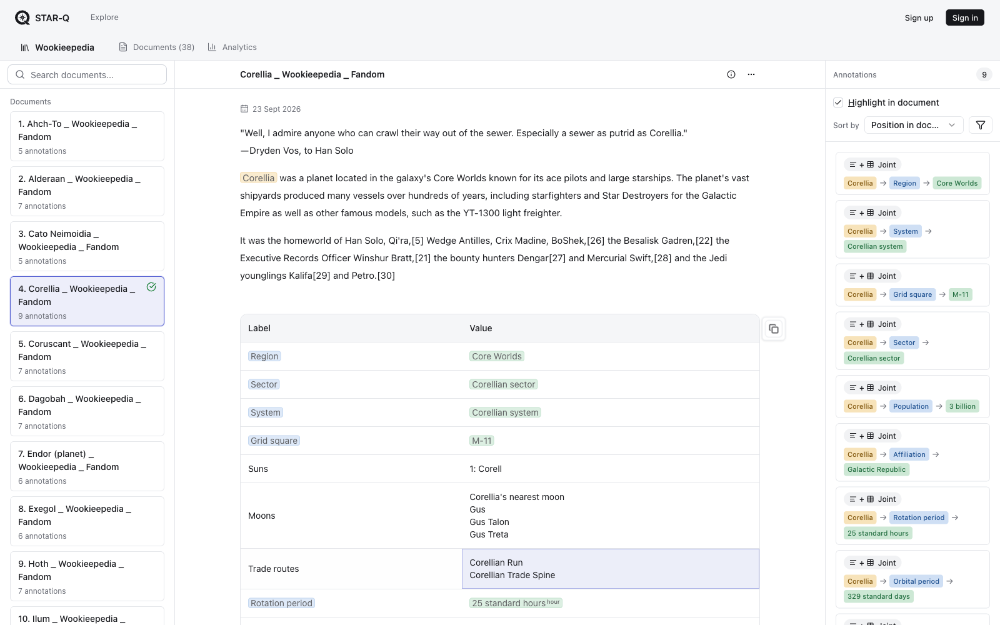
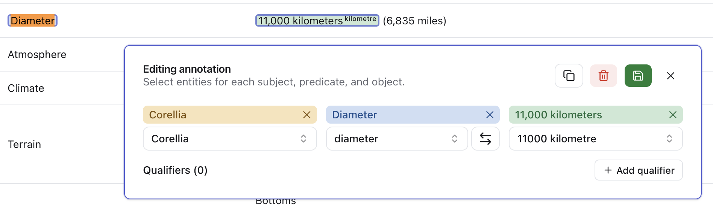
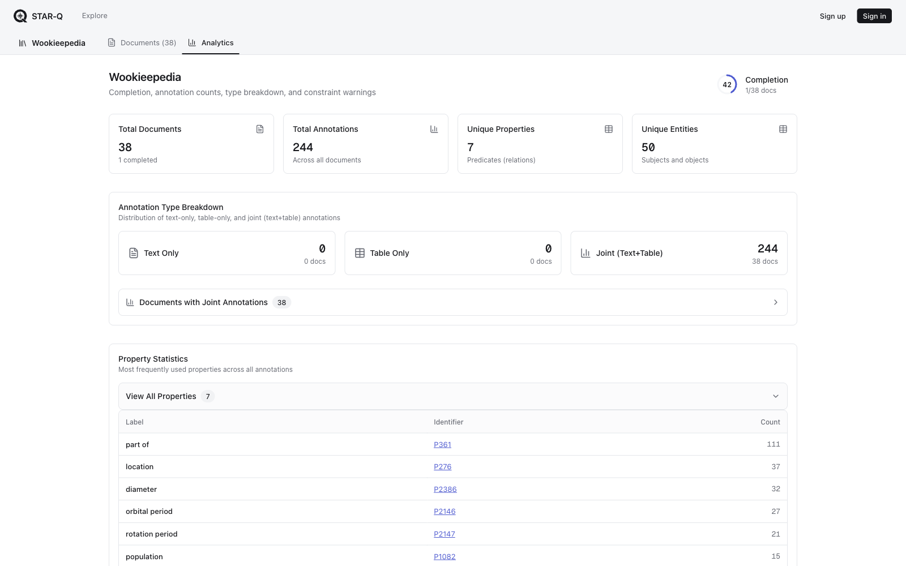

## STAR-Q - Span and Table Annotation for RDF with Qualifiers

An open-source web platform for **annotating texts and tables with qualified knowledge graph statements**: annotators highlight subject, predicate, object, and qualifier mentions directly in a document, then disambiguate each mention against a reference knowledge graph. It works with Wikidata out of the box, and any other Wikibase instance, such as an enterprise knowledge graph, can be registered and selected per corpus.

Every annotation follows the Wikibase statement model: a subject, a predicate, and an object, each resolved against the corpus's Wikibase instance. Qualifiers add ordered predicate-value pairs. A value can also be a corpus-local entity, a typed literal, or a quantity with a unit and optional lower and upper bounds.

Supported document formats include plain text, Markdown, HTML, and Wikitext, CSV or TSV files, Label Studio exports, and ZIP archives. Corpora can be shared through teams with per-corpus roles. Analytics pages track completion, property and entity usage, and unassigned mentions.

Annotations can be exported as JSON, RDF 1.2 Turtle, or QuickStatements 3.0 commands ready for submission to Wikidata. The RDF export has a truthy mode and a full mode that preserves component-level text and table evidence with DCAT, PROV, NIF, CSVW, and Web Annotations. There is also a REST API which exposes corpora, entities, analytics, and exports.

**Access**

- 🌐 Live instance with example corpora: [https://starq.ecladatta.eurecom.fr/explore](https://starq.ecladatta.eurecom.fr/explore)
- 📦 Source code (Apache 2.0): [https://github.com/ecladatta/star-q](https://github.com/ecladatta/star-q)
- 📄 Paper: [https://hal.science/hal-05802341v1](https://hal.science/hal-05802341v1)

**How to cite**

> Thibault Ehrhart, Yoan Chabot, Raphaël Troncy. *STAR-Q: A Web-Based Platform for Annotating Qualified Knowledge Graph Statements in Texts and Tables.* 6th Wikidata Workshop @ ISWC 2026, Bari, Italy, October 2026.
